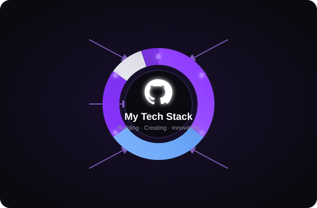
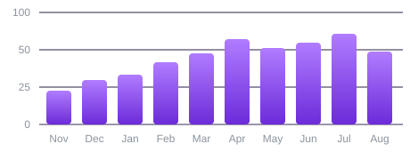
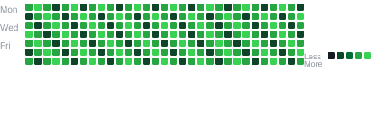

<!-- Theme: white #FFFFFF / black #111 / grey #30363D -->

<!-- ============ 1. IDENTITY ============ -->

<h1 style="margin:0 0 6px;font-size:36px;letter-spacing:1px;color:#111111;">KEITH WILL</h1>

Creative Technologist &nbsp;&middot;&nbsp; Product Designer &nbsp;&middot;&nbsp; Full-Stack Developer

 

<!-- ============ 2. HERO BANNER ============ -->

 

<!-- ============ 3. ABOUT ============ -->

<h2 style="margin:0 0 20px;font-size:26px;color:#111111;">About Me

</h2>

<table>
<tr>
<td width="56%" valign="top">

I'm a <strong style="color:#111111;">Creative Technologist</strong> and <strong style="color:#111111;">Product Builder</strong> based in Kenya, working at the intersection of design and software. I take ideas from rough concept to fully-functional, visually polished digital products &mdash; handling both the interface people see and the systems running underneath.

I'm not interested in building demos. I'm interested in building <strong style="color:#111111;">real products</strong> &mdash; ambitious concepts actually engineered into something people open every day.

role      Creative Technologist / Product Builder 
focus     Design &middot; Software &middot; AI &middot; Automation 
approach  Imagine &rarr; Design &rarr; Build &rarr; Improve

</td>
<td width="8%"></td>
<td width="36%" valign="top">

 

"Don't just build demos. Build the real product that people open every day &mdash; the one that solves the problem and feels right to use."

</td>
</tr>
</table>

 

<!-- ============ 4. TECH STACK ============ -->

<h2 style="margin:0 0 6px;font-size:26px;color:#111111;">Tech Stack

</h2>

Technologies I work with and their usage

<!-- Donut chart centered; categories arranged around it -->
<table style="width:100%;border-collapse:separate;border-spacing:0 0;">
<tr>
<td width="33%" valign="middle" align="right">

<!-- Languages & Frontend -->

<strong style="color:#111111;font-size:14px;">Languages &amp; Frontend</strong>
35%

<!-- Backend & Data -->

<strong style="color:#111111;font-size:14px;">Backend &amp; Data</strong>
30%

<!-- Tools & Platforms -->

<strong style="color:#111111;font-size:14px;">Tools &amp; Platforms</strong>
20%

</td>

<td width="34%" valign="middle" align="center">

</td>

<td width="33%" valign="middle" align="left">

<!-- Design -->

<strong style="color:#111111;font-size:14px;">Design</strong>
10%

<!-- Others -->

<strong style="color:#111111;font-size:14px;">Others</strong>
5%

</td>
</tr>
</table>

Percentages are a visual representation of relative tool breadth across my projects, not measured usage data.

 

<!-- ============ 5. GITHUB ANALYTICS ============ -->

<h2 style="margin:0 0 6px;font-size:26px;color:#111111;">GitHub Analytics

</h2>

Activity, contributions and more

<!-- Stat cards (4 across on desktop) -->
<table style="width:100%;border-collapse:separate;border-spacing:14px;">
<tr>
<td width="25%" valign="top">

TOTAL CONTRIBUTIONS

&mdash;

</td>
<td width="25%" valign="top">

TOTAL STARS

0

</td>
<td width="25%" valign="top">

TOTAL GITHUB PROJECTS

4

</td>
<td width="25%" valign="top">

TOTAL COMMITS

0

</td>
</tr>
</table>

 

<!-- Contribution activity (bar chart) + streak/heatmap -->
<table style="width:100%;border-collapse:separate;border-spacing:14px;">
<tr>
<td width="54%" valign="top">

CONTRIBUTION ACTIVITY

</td>
<td width="46%" valign="top">

CONTRIBUTION STREAK

<table>
<tr>
<td width="40%" valign="top">

&mdash;

day streak

Keep going!

</td>
<td width="60%" valign="middle">

</td>
</tr>
</table>

</td>
</tr>
</table>

 

<!-- Live stats + live streak -->

LIVE GITHUB METRICS

  

GITHUB TROPHIES

 

<!-- ============ 6. SELECTED WORK ============ -->

<h2 style="margin:0 0 6px;font-size:26px;color:#111111;">Selected Work

</h2>

Featured projects &mdash; a mix of shipped products, AI systems, and platform work.

<!-- AUTO:RECENT:START -->
_This block is auto-generated on every push and on a daily schedule. The first run fills in your 6 most recently pushed public repositories._
<!-- AUTO:RECENT:END -->

<table style="width:100%;border-collapse:separate;border-spacing:14px;">
<tr>
<td width="33%" valign="top">

<h3 style="margin:0 0 8px;font-size:20px;color:#111111;">Zyra</h3>

Social media management platform that automates and streamlines publishing workflows across multiple platforms.

<code style="background:#F5F5F7;color:#111111;padding:3px 9px;border-radius:7px;">Next.js</code> <code style="background:#F5F5F7;color:#111111;padding:3px 9px;border-radius:7px;">Supabase</code> <code style="background:#F5F5F7;color:#111111;padding:3px 9px;border-radius:7px;">Drizzle</code>

</td>
<td width="33%" valign="top">

<h3 style="margin:0 0 8px;font-size:20px;color:#111111;">LYRA</h3>

A persistent desktop AI companion built around an animated 3D character, voice interaction, and deep computer integration.

<code style="background:#F5F5F7;color:#111111;padding:3px 9px;border-radius:7px;">Electron</code> <code style="background:#F5F5F7;color:#111111;padding:3px 9px;border-radius:7px;">Three.js</code> <code style="background:#F5F5F7;color:#111111;padding:3px 9px;border-radius:7px;">Node.js</code>

</td>
<td width="33%" valign="top">

<h3 style="margin:0 0 8px;font-size:20px;color:#111111;">GhostSync</h3>

Full-stack web platform built around authentication, real-time communication, and modern application architecture.

<code style="background:#F5F5F7;color:#111111;padding:3px 9px;border-radius:7px;">React</code> <code style="background:#F5F5F7;color:#111111;padding:3px 9px;border-radius:7px;">Node.js</code> <code style="background:#F5F5F7;color:#111111;padding:3px 9px;border-radius:7px;">SQLite</code>

</td>
</tr>
<tr>
<td width="33%" valign="top">

<h3 style="margin:0 0 8px;font-size:20px;color:#111111;">Moon</h3>

A technology and product ecosystem concept spanning custom hardware, software, branding, and security.

<code style="background:#F5F5F7;color:#111111;padding:3px 9px;border-radius:7px;">Full-stack</code> <code style="background:#F5F5F7;color:#111111;padding:3px 9px;border-radius:7px;">Branding</code>

</td>
<td width="33%" valign="top">

<h3 style="margin:0 0 8px;font-size:20px;color:#111111;">Soostori POS</h3>

A point-of-sale system concept designed around real-world business operations and communication needs.

<code style="background:#F5F5F7;color:#111111;padding:3px 9px;border-radius:7px;">Node.js</code> <code style="background:#F5F5F7;color:#111111;padding:3px 9px;border-radius:7px;">M-Pesa Daraja</code>

</td>
<td width="33%" valign="top">

<h3 style="margin:0 0 8px;font-size:20px;color:#111111;">Portfolio</h3>

Personal portfolio and brand site built with modern design principles.

<code style="background:#F5F5F7;color:#111111;padding:3px 9px;border-radius:7px;">Next.js</code> <code style="background:#F5F5F7;color:#111111;padding:3px 9px;border-radius:7px;">Tailwind</code>

</td>
</tr>
</table>

 

<!-- ============ 7. CONNECT ============ -->

<h2 style="margin:0 0 14px;font-size:26px;color:#111111;">Connect

</h2>

I share work, build in the open, and collaborate on ambitious projects. Links update as my public profiles are finalized.

 

<!-- ============ 8. CLOSING ============ -->

_Thanks for stopping by. I'm building things that matter &mdash; and if you want to build something real, let's talk._

